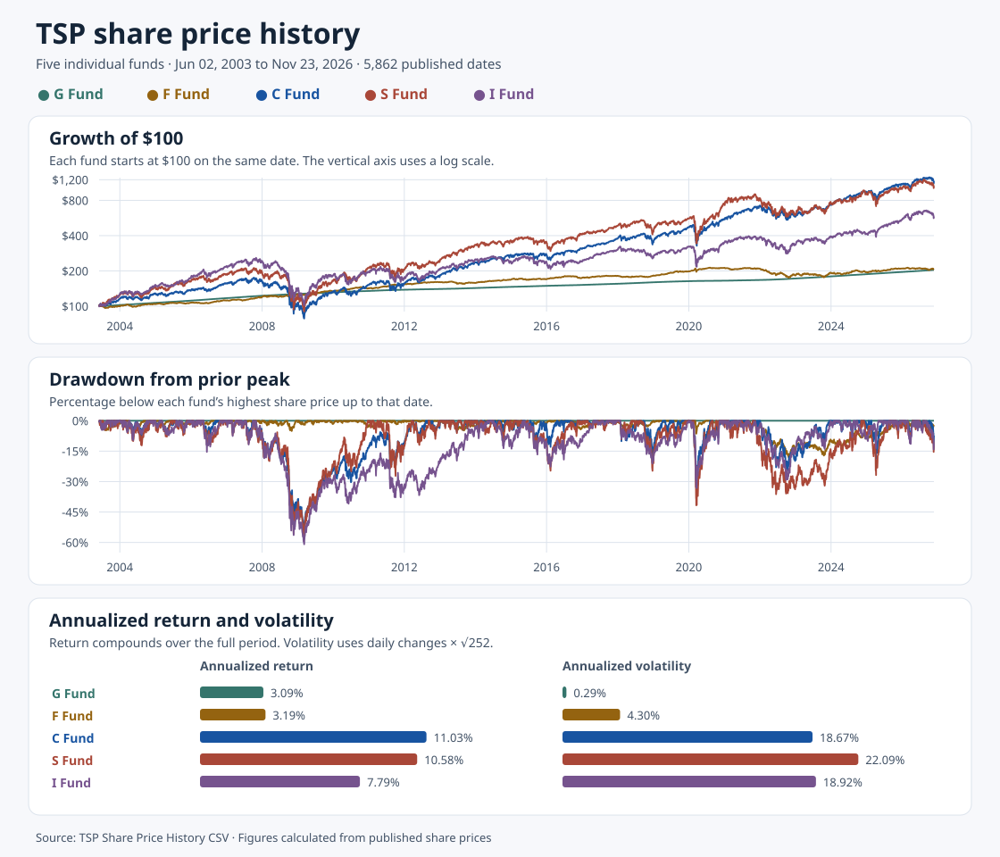

# TSP Share Price History

Historical Thrift Savings Plan (TSP) fund share prices in a public CSV for
spreadsheets, notebooks, and other projects.

[Download the CSV](data/tsp-share-price-history.csv?raw=1)

## Example analysis



This snapshot uses published prices from June 2, 2003 through November 23,
2026. Run the Python example below to plot growth through the latest date in
the CSV.

## Quick start with Python

With pandas installed (`python -m pip install pandas`), load the CSV directly from GitHub:

```python
import pandas as pd

url = (
    "https://raw.githubusercontent.com/CAshad0w/tsp-share-price-history/main/"
    "data/tsp-share-price-history.csv"
)
prices = pd.read_csv(url, parse_dates=["Date"])
print(prices[["Date", "C Fund"]].tail())
print("Latest price date", prices["Date"].max().date())
```

To plot how $100 would have grown in each individual fund, install Matplotlib
(`python -m pip install matplotlib`) and run:

```python
import matplotlib.pyplot as plt

funds = ["G Fund", "F Fund", "C Fund", "S Fund", "I Fund"]
share_prices = prices.set_index("Date")[funds]
growth = 100 * share_prices.div(share_prices.iloc[0])
growth.plot(title="Growth of $100 in the five individual TSP funds", ylabel="Value in USD")
plt.tight_layout()
plt.show()
```

## About the data

The CSV has one row per published price date, sorted oldest to newest. `Date`
uses `YYYY-MM-DD`. Fund columns contain share prices in U.S. dollars and cover
the individual and Lifecycle funds included in the source exports. Blank cells
indicate that the dataset has no price for that fund on that date.

This is an independent mirror of exports from the
[official TSP share price history page](https://www.tsp.gov/share-price-history/).
Coverage starts June 2, 2003. The final CSV row gives the latest price date. To
reproduce an analysis, use the CSV from a specific Git commit.

## How updates work

The dataset was seeded with TSP's All Time export. Updates are imported manually
from TSP's **All share prices** CSV exports. The updater adds missing price dates
and refreshes overlapping dates without creating duplicates.

From the repo root on macOS or Linux, merge a **5 days** or **Last 30 days** export
with Python 3:

```bash
python3 update_tsp_history.py \
  --input-csv ~/Downloads/tsp-latest.csv \
  --output data/tsp-share-price-history.csv
```

Replace the input path with the location of your download. The manual import
runs without Playwright.

## License and data source

The updater script, `update_tsp_history.py`, is licensed under the
[MIT License](LICENSE).

The CSV in `data/` mirrors share prices published by the
[Thrift Savings Plan](https://www.tsp.gov/share-price-history/).
The repository maintainer claims no ownership of the source data.
The MIT License covers the updater script only.
